# Implementation Guide

Detailed architecture, data flow, and implementation reference for the AI Code Review Agent.

---

## System Overview

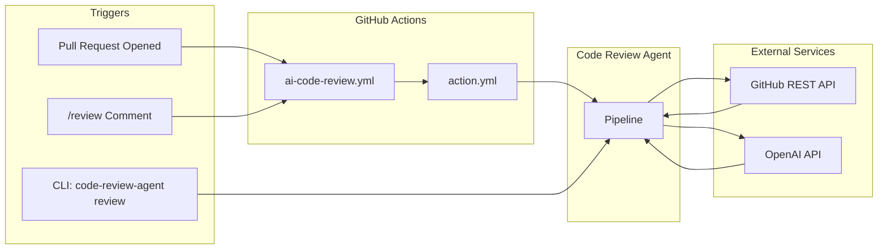

The agent can be triggered three ways:
1. **Automatically** — GitHub Action fires on PR open/sync/reopen
2. **On demand** — comment `/review` on any open PR
3. **Locally** — `code-review-agent review <PR_URL>` from the command line

---

## Pipeline Architecture

The core of the agent is a 5-stage pipeline defined in `pipeline.py`:

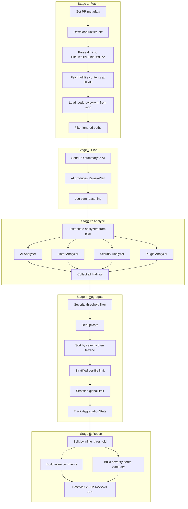

---

## Data Model

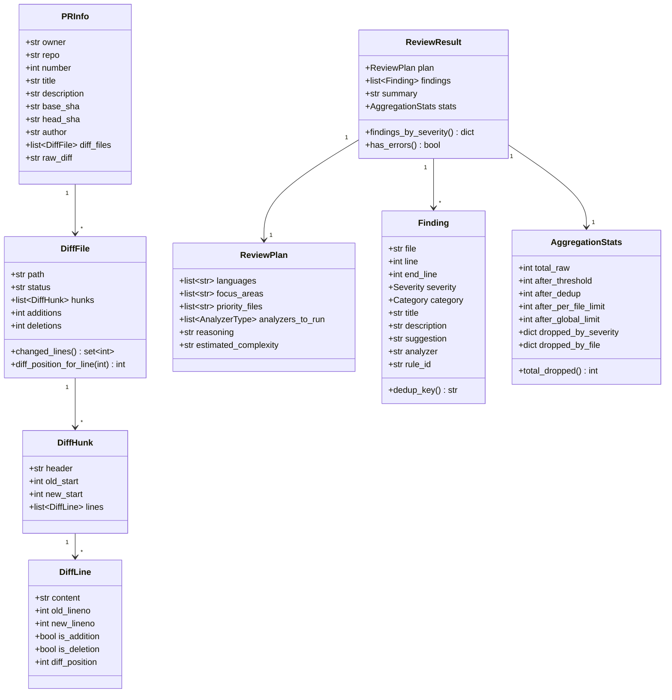

### Enums

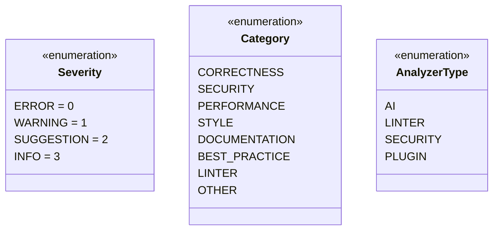

---

## Analyzer Architecture

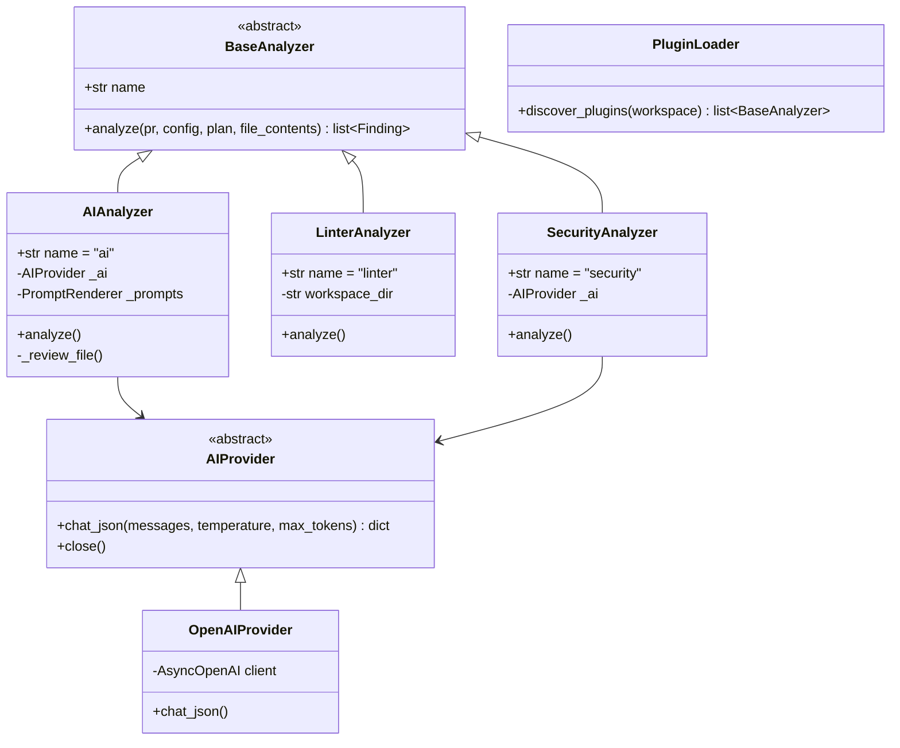

### AI Analyzer Flow

For each file, the AI analyzer sends one request per focus area:

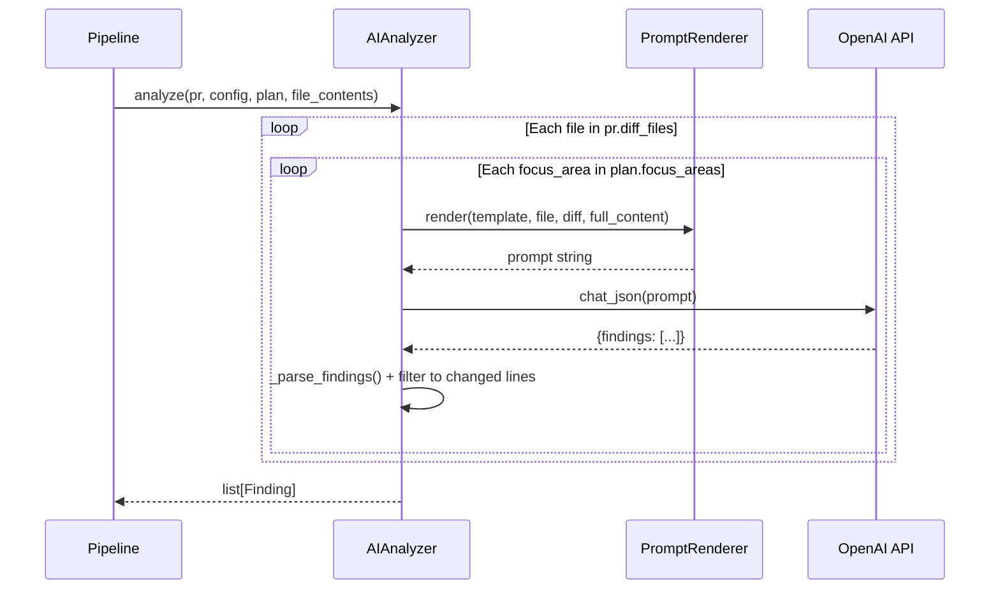

**Current cost**: N files × F focus areas = N×F API calls (e.g., 4 files × 4 areas = 16 calls).

### Linter Integration

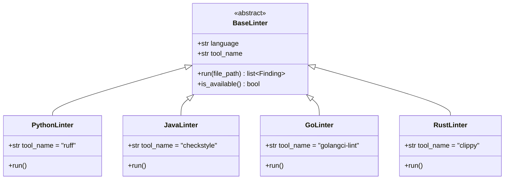

Linters run on the full file but findings are **filtered to changed lines only** — pre-existing issues are not reported.

---

## Severity and Aggregation Pipeline

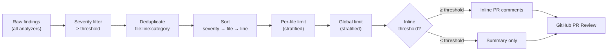

### Stratified Limiting

The stratified limiter ensures every severity tier gets representation, even when hitting caps:

```
1. Guarantee 1 slot per tier that has findings (error, warning, suggestion, info)
2. Fill remaining slots in severity-priority order (errors first)
3. Re-sort for consistent output
```

This prevents a flood of low-severity style findings from pushing out a critical security issue.

### Summary Output Structure

```
## 🔍 Code Review Summary
Found **N** issue(s) across **M** file(s).

### 🚨 Critical Issues          ← always expanded
- file:line — title

### ⚠️ Warnings                  ← always expanded
- file:line — title

<details>
<summary>💡 Suggestions (N)</summary>   ← collapsed
- file:line — title
</details>

<details>
<summary>ℹ️ Info (N)</summary>           ← collapsed
- file:line — title
</details>

ℹ️ X finding(s) filtered out: ...     ← aggregation stats
```

---

## GitHub Action Integration

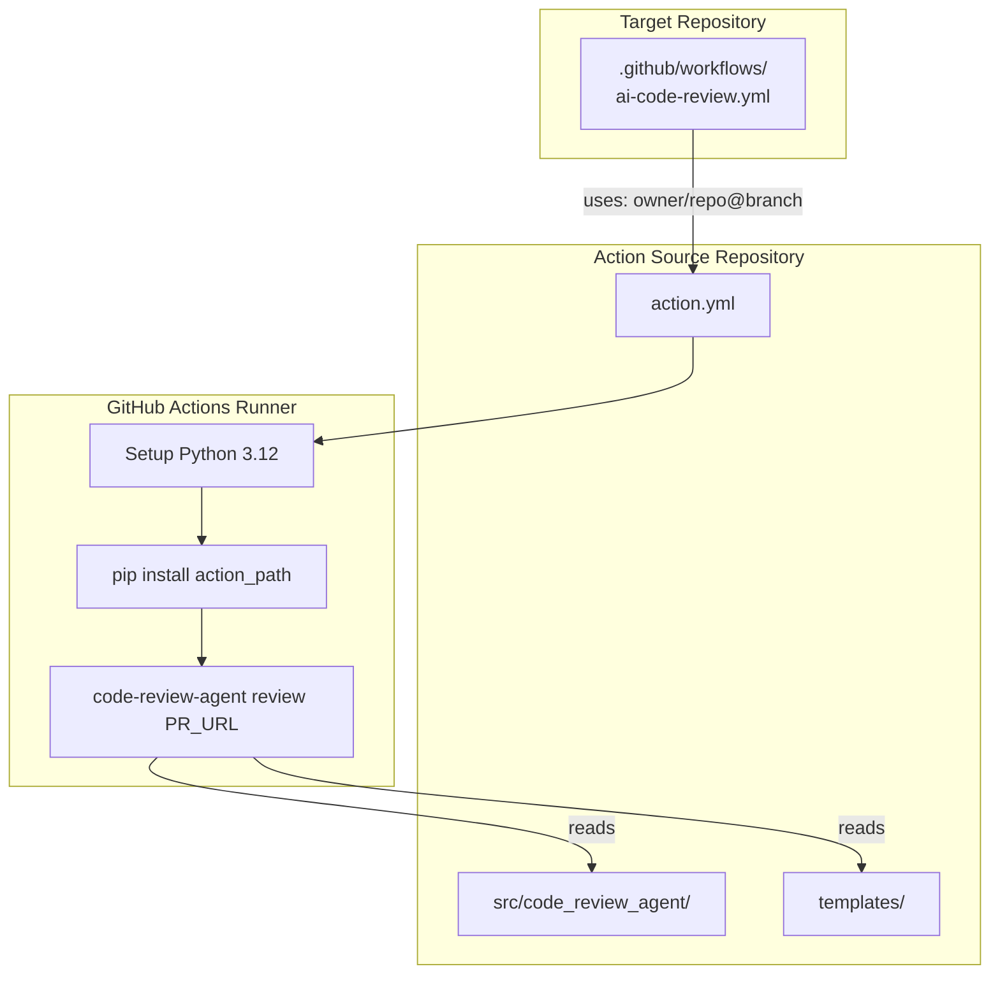

Key design: the target repo's workflow **references** this repo's `action.yml` — no agent code is copied. Updates to the agent are picked up automatically (or pinned via `--branch`).

### Secrets Required

- **`OPENAI_API_KEY`** — must be set as a GitHub Actions secret on the target repo
- **`GITHUB_TOKEN`** — provided automatically by GitHub Actions (no setup needed)

---

## Configuration Hierarchy

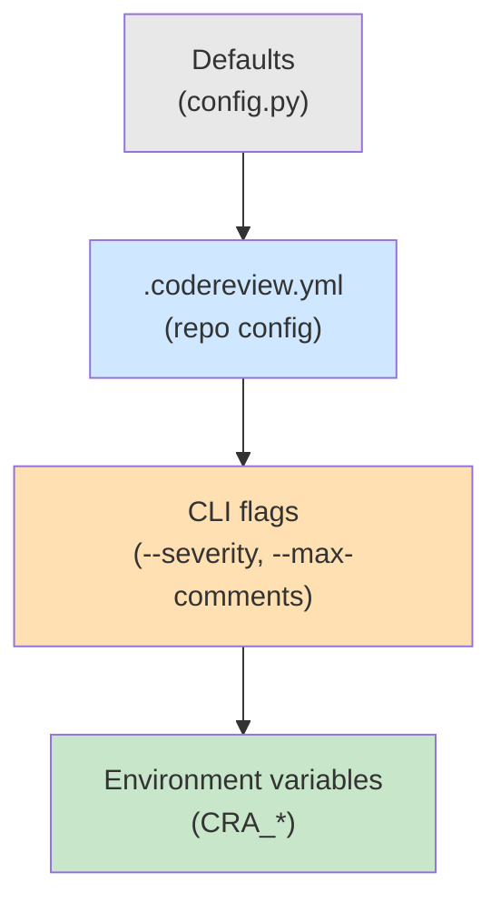

Later sources override earlier ones. Environment variables (via pydantic-settings) override everything.

---

## Prompt Template System

Templates live in `src/code_review_agent/ai/templates/` as Jinja2 `.md.j2` files:

- `planning.md.j2` — planning phase prompt
- `review_correctness.md.j2` — correctness focus
- `review_security.md.j2` — security focus
- `review_performance.md.j2` — performance focus
- `review_style.md.j2` — style focus

Repos can override any template by placing files in `.codereview/prompts/`.

Each template receives:
- PR metadata (title, file path, language)
- Full file content (for context)
- Diff (the actual changes to review)
- Custom instructions (from `.codereview.yml`)

---

## Install Script Architecture

`scripts/install.sh` supports two modes:

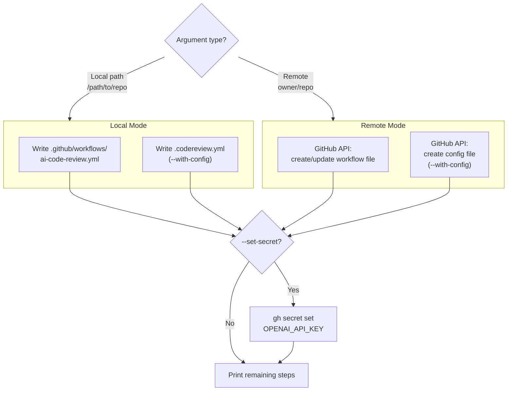

The script auto-detects the action source repo from `git remote get-url origin` — it works from any clone of this project without hardcoded paths.

---

## Improvement Roadmap

Improvements are listed in priority order. Items marked 🟢 are ready to implement; 🟡 need some design; 🔴 are exploratory.

### Priority 1: LLM Cost Reduction (Critical)

**A1. Runtime Prompt Merge** 🟢
- **Impact**: ~75% fewer API calls and input tokens
- **Effort**: Low
- **Description**: Keep the 4 prompt templates as separate files on disk. At runtime, `PromptRenderer.render_combined()` merges the Instructions and Severity Guidelines sections from all focus areas into a single prompt per file. The inner `for focus_area` loop in `ai_analyzer.py` is replaced by one `_review_file_combined()` call.
- **Files**: `ai/prompts.py`, `analyzers/ai_analyzer.py`
- **Current**: N files × 4 focus areas = 4N API calls → **becomes N calls**

### Priority 2: Non-LLM Pattern Detection (High)

**B. PatternAnalyzer** 🟢
- **Impact**: Instant detection of common issues, zero API cost
- **Effort**: Medium
- **Description**: New `analyzers/pattern_analyzer.py` with regex-based `PatternRule` dataclasses. Runs on diff additions only. Always runs regardless of plan.
- **Patterns**:
  - **Secrets**: AWS keys, GitHub tokens, API keys, private keys → severity: error
  - **SQL injection**: string interpolation in SQL contexts (Python, Java, Go) → severity: error
  - **Command injection**: `os.system(f"...")`, `subprocess.call(shell=True)` → severity: error
  - **Code smells**: TODO/FIXME (info), print statements (suggestion), mutable defaults (warning), broad exceptions (warning)
- **Each rule carries a `suggestion` field** with the recommended fix

### Priority 3: Concurrency (High)

**A2. Concurrent File Reviews** 🟢
- **Impact**: ~5× faster wall-clock time
- **Effort**: Low
- **Description**: Replace sequential `for` loop in `ai_analyzer.analyze()` with `asyncio.gather` + `Semaphore(5)`.
- **Files**: `analyzers/ai_analyzer.py`

### Priority 4: Better Suggested Fixes (Medium)

**C1. Strengthen Prompt Guidance** 🟢
- **Impact**: More actionable suggestions, fewer explanatory-text-as-code suggestions
- **Effort**: Low
- **Description**: Update prompt templates to explicitly require that `suggestion` is exact replacement code (not explanation). Add good/bad examples. If no code fix applies, use `null`.
- **Files**: All 4 `review_*.md.j2` templates

**C2. Pattern Analyzer Includes Fixes** 🟢
- **Impact**: Every regex-detected finding has a concrete fix
- **Effort**: Included in B (PatternAnalyzer)

**C3. Linter Suggestions** 🟡
- **Impact**: Ruff already provides fix suggestions. Add fix extraction for other linters.
- **Effort**: Low per linter, but requires each linter to be installed

### Priority 5: Cleanup (Low)

**A3. Remove SecurityAnalyzer** 🟢
- **Impact**: Code simplification
- **Effort**: Trivial
- **Description**: `SecurityAnalyzer` is a no-op when the AI analyzer covers security (always true with default config). Remove it.
- **Files**: `pipeline.py`, delete `analyzers/security_analyzer.py`

### Priority 6: Smart Depth (Medium)

**A4. Planner-Driven Review Depth** 🟡
- **Impact**: Fewer tokens for low-priority files
- **Effort**: Medium
- **Description**: Use `plan.priority_files` (currently computed but ignored) to create two review tiers:
  - **Priority files**: Full review with file content + diff
  - **Non-priority files**: Diff-only, shorter prompt, high-severity issues only
- **Files**: `ai_analyzer.py`, new template `review_quick.md.j2`

### Priority 7: Batch Small Files (Low)

**A5. Batch Small Files** 🟡
- **Impact**: Fewer API calls for PRs with many small files
- **Effort**: High (token budget management, response parsing)
- **Description**: Group files under ~50 changed lines into batched API calls. One prompt contains multiple files separated by `### File: path`.

### Priority 8: Large File Handling (Low)

**A6. Diff-Only for Large Files** 🟡
- **Impact**: Avoid context window limits on large files
- **Effort**: Low
- **Description**: Add `max_file_context_lines` config (default 500). Omit full file content for files exceeding the threshold.
- **Files**: `config.py`, `ai_analyzer.py`

### Future Ideas 🔴

- **Anthropic/local model support** — Subclass `AIProvider` for Claude, Ollama, etc.
- **Incremental reviews** — Only review new commits since last review
- **Learning from feedback** — Track which suggestions are accepted/rejected to tune prompts
- **PR size warnings** — Flag PRs that are too large to review effectively
- **Dependency vulnerability scanning** — Check lock files against CVE databases
- **Auto-fix PRs** — Create fix commits for accepted suggestions

---

## File Reference

```
├── action.yml                    # GitHub Action definition (composite)
├── Dockerfile                    # Container build
├── Makefile                      # Dev commands
├── pyproject.toml                # Package config (hatchling, deps, ruff)
├── .codereview.yml               # This repo's review config
├── .env.example                  # Template for local credentials
│
├── .github/workflows/
│   ├── ai-code-review.yml        # Auto-review on PR (installed by install.sh)
│   ├── ci.yml                    # CI: tests + lint
│   ├── create-test-pr.yml        # Manually create test PRs via Actions UI
│   └── self-review.yml           # Self-review workflow (dev)
│
├── scripts/
│   └── install.sh                # Install into any repo (local or remote)
│
├── src/code_review_agent/
│   ├── __init__.py
│   ├── __main__.py               # python -m entry point
│   ├── cli.py                    # Click CLI (review, test-pr)
│   ├── config.py                 # Pydantic config models + YAML loading
│   ├── models.py                 # All data models + enums
│   ├── pipeline.py               # 5-stage orchestration + aggregation
│   ├── planner.py                # AI planning phase
│   ├── reporter.py               # GitHub review posting
│   ├── diff_parser.py            # Unified diff parser
│   ├── github_client.py          # Async GitHub REST API wrapper
│   │
│   ├── ai/
│   │   ├── base.py               # Abstract AIProvider
│   │   ├── openai_provider.py    # OpenAI implementation
│   │   ├── prompts.py            # Jinja2 template renderer
│   │   └── templates/
│   │       ├── planning.md.j2
│   │       ├── review_correctness.md.j2
│   │       ├── review_security.md.j2
│   │       ├── review_performance.md.j2
│   │       └── review_style.md.j2
│   │
│   ├── analyzers/
│   │   ├── base.py               # Abstract BaseAnalyzer
│   │   ├── ai_analyzer.py        # LLM-based analysis
│   │   ├── linter_analyzer.py    # Classical linting
│   │   └── security_analyzer.py  # Security pass (delegates to AI)
│   │
│   ├── linters/
│   │   ├── base.py               # Abstract BaseLinter + factory
│   │   ├── python_linter.py      # ruff
│   │   ├── java_linter.py        # checkstyle
│   │   ├── go_linter.py          # golangci-lint
│   │   └── rust_linter.py        # clippy
│   │
│   └── plugins/
│       └── loader.py             # Custom plugin discovery
│
├── test_harness/
│   ├── create_test_pr.py         # Creates test PRs with known bugs
│   └── test_files/               # Intentionally buggy code
│       ├── JavaIssues.java       # Deadlocks, SQL injection, concurrency
│       ├── python_issues.py      # Threading, generators, injection
│       ├── go_issues.go          # Channels, mutexes, goroutine leaks
│       └── rust_issues.rs        # Mutex ordering, unsafe, panics
│
├── tests/                        # Unit tests (pytest + pytest-asyncio)
│
└── docs/
    ├── ARCHITECTURE.md           # High-level design
    └── IMPLEMENTATION.md         # This file
```
